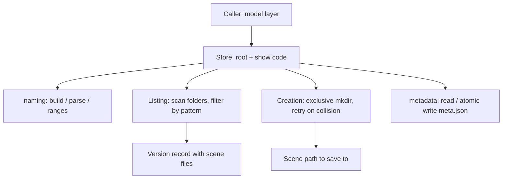

# Previs File Manager Backend API - Plan

## Goal Capsule

- **Objective:** A file/scene manager can find, create, and annotate previs scenes, organized by sequence, action, and version, through one backend API that follows the project's naming and folder conventions.
- **Means:** A standard-library Python package behind a small store object bound to a root and show code (KTD1, KTD2).
- **Product authority:** The Product Contract wins on behavior; a KTD wins on implementation mechanism; a unit overrides neither. This plan covers the backend API only; the PyQt MVC UI that will call it is not active scope.
- **Execution profile:** Code, on branch `7-previs-file-manager-api`, landing as a PR containing `Closes #7`. Tests are written alongside each unit.
- **Stop conditions:** Stop and ask if implementation shows the root cannot be assumed to be local disk or SMB (see Dependencies / Assumptions), since R8 depends on it.
- **Who finishes:** `ce-work` implements and verifies, then opens the PR.
- **Open blockers:** None.

Product Contract preservation: changed: R1 only, to state the folder names on disk (`0100`, `a007`, `v003`) that the original text left open; R4 and R13 now cite those names. Every other R, AE, and decision is unchanged.

---

## Product Contract

### Summary

A pure-Python backend, with no Maya or Qt dependency, manages the previs folder tree. It lists sequences, actions, and versions, creates sequences and actions, allocates the next version and returns the scene path to save to, finds the latest version, parses and builds scene names, and reads and writes a comment on an action or version. It is given the previs file root and the show code explicitly, and a new `PREVIS_FILE_ROOT` setting is added to the config defaults. Terms follow `GLOSSARY.md`: Sequence, Action, Version, Scene file.

### Problem Frame

The PyQt/Maya file manager has nothing to read from or write to yet. Scenes live in a folder tree (sequence, then action, then version) whose naming rules exist only as a convention, so every caller would otherwise reimplement them. The UI's model layer needs one place that owns the conventions and that can be tested outside Maya.

### Key Decisions

- **Backend is independent of Maya, Qt, and the config module.** The root and show code are passed in; callers read `PREVIS_FILE_ROOT` and the show code from config. Governs R1, R12. (session-settled: user-directed — chosen over reading config inside the API: user wants the root passed in so the backend is reusable and testable.)
- **Sequence numbers step by 100; action and version numbers step by 1; callers may always pass an explicit number.** Sequence numbers carry production meaning and leave room to insert sequences between existing ones; gaps are normal for sequences and actions and rare for versions. Governs R7, R8. (session-settled: user-directed — chosen over max+1 for sequences: user wants sequences in hundreds.)
- **Numbers have fixed widths and never widen.** Overflow is an error because parsing depends on the fixed width. Governs R1, R3, R7, R8. (session-settled: user-directed — chosen over widening the field: user chose overflow as an error.)
- **Action and version folders carry their letter prefix.** `a007` and `v003` match the letters in the scene filename, so the tree is self-describing in Explorer. Governs R1. (session-settled: user-directed — chosen over bare-number folders and a prefixed sequence folder: user picked prefixed action and version folders.)
- **A version's scene files are found by matching the name stem, with any extension.** The extension can change over a project's life, and a folder with a `.mb` file must not be flagged missing because a caller asked for `.ma`. Governs R5, R9.
- **Versions are listed even when they have no scene file, and version numbers are never reused.** A failed or abandoned save leaves a visible, flagged version instead of a silent gap or a reused number. Governs R5, R6, R8.
- **A missing parent is an error, but a fresh show with no folders is normal.** A wrong sequence or action number fails loudly instead of creating a stray folder. Governs R4, R7, R13.
- **Metadata is a comment only for now,** stored so more fields can be added later without moving files. Governs R10, R11.

### Requirements

**Layout and naming**

- R1. The tree under the root is `sequences/<sequence>/a<action>/v<version>/`, where sequence is 4 digits, action is 3 digits, and version is 3 digits, all zero padded (for example `sequences/0100/a007/v003/`). Sequences and actions run from 0; versions run from 1. A Scene file is named `<showcode>_<sequence>_a<action>_v<version>.<ext>` and lives in its version folder.
- R2. Action numbers are scoped to their sequence; the same action number under different sequences is unrelated.
- R3. The API builds a scene name from its parts and parses a name back into show code, sequence, action, and version, rejecting names that don't match R1, including numbers outside the ranges above.
- R4. Folders and files that don't match the naming convention in R1, or whose name carries a different show code, are ignored by every listing.

**Listing and lookup**

- R5. The API lists sequences, the actions under a sequence, and the versions under an action, each in ascending numeric order. A version entry lists its scene files (every file in the folder whose stem is the version's name, with any extension, in sorted order); an empty list means the scene file is missing.
- R6. The API finds the latest version of an action, whether or not it has a scene file. It does not offer a "latest with a scene file" lookup; callers filter the list from R5.

**Creation**

- R7. The API creates a sequence or an action using a caller-supplied number or, on request, the next free number. For sequences the next free number is the next multiple of 100 above the highest existing sequence (0 when there are none); for actions it is one above the highest existing action (0 when there are none). Creating one that already exists, or a number out of range, is an error. Creating an action under a sequence that doesn't exist is an error.
- R8. The API allocates the next version of an action by creating its folder and returning the scene path the caller should save to. The number is one above the highest existing version (1 when there are none), and two simultaneous allocations never receive the same number. Exceeding version 999 is an error.
- R9. The scene file extension (such as `.ma` or `.mb`) is supplied by the caller and used only to build the path returned by R8; the API does not fix one.

**Metadata**

- R10. An action and a version each have a comment that the API can read and write. A missing comment reads as empty, not as an error. A comment is never seen half written, and when two people save at once the last write wins.
- R11. A comment is stored and returned exactly as written, including Unicode text, multiple lines, and emoji.

**Settings and missing folders**

- R12. `PREVIS_FILE_ROOT` is added to `config/defaults.yaml` as a default setting, empty, that shows can override. The API appends `sequences` to the root it is given; checking that the root is set is the caller's job.
- R13. Listing the actions of a sequence, or the versions of an action, that doesn't exist is a not-found error. Listing sequences when the `sequences` folder doesn't exist returns an empty list, and creating the first sequence creates that folder.

### Acceptance Examples

- AE1. **Covers R5, R8.** Given an action with versions 1 and 2 where version 2 has no scene file, when the versions are listed, both appear and version 2 has an empty scene-file list; allocating the next version creates 3, not a second 2.
- AE2. **Covers R7.** Given sequence 100 exists, when a caller creates sequence 100 with an explicit number, the call fails and nothing changes. When a caller asks for the next free sequence number, 200 is created; if the highest sequence is 150, the result is also 200.
- AE3. **Covers R4.** Given a `notes` folder and a file `readme.txt` next to the action folders, when actions are listed, neither appears and no error is raised.
- AE4. **Covers R10, R11.** Given a version comment of "Caméra déplacée — 新しい", with a second line and an emoji, when it is written and read back, the text is identical.
- AE5. **Covers R10.** Given an action with no comment, when its comment is read, the result is an empty comment.
- AE6. **Covers R3.** Given the name `abc_0100_a007_v012`, when parsed, the result is show `abc`, sequence 100, action 7, version 12; a name with a two-digit version, or version 0, is rejected.
- AE7. **Covers R5, R4.** Given a version folder containing `abc_0100_a007_v003.ma`, `abc_0100_a007_v003.mb`, `abc_0100_a007_v003.ma.bak`, and `xyz_0100_a007_v003.ma`, when it is listed for show `abc`, the scene files are the `.ma` and `.mb` files only.
- AE8. **Covers R7, R13.** Given no sequence 300, when an action is created under sequence 300, the call fails and no folder is made. Given no `sequences` folder, listing sequences returns an empty list, and creating sequence 0 makes the folder.
- AE9. **Covers R7.** Given no sequences, the first next-free sequence is 0 and the second is 100; given no actions in a sequence, the first next-free action is 0, then 1. A request that would exceed 9999 (sequence) or 999 (action) fails.
- AE10. **Covers R8.** Given several callers allocating the next version of the same action at the same moment, each receives a different version number and none fail with a collision.

### Scope Boundaries

Deferred for later:

- Delete, rename, and move of sequences, actions, and versions.
- Metadata fields beyond the comment.
- Locking or conflict handling when two people edit the same comment.
- A "latest version with a scene file" lookup.
- Any UI, and any Maya open/save integration.

Considered and not built:

- Path-length handling for deep Windows paths. The tree is at most five levels below the root; a root short enough for Maya's own paths leaves ample room.

---

## Planning Contract

### Key Technical Decisions

- KTD1. **One package, standard library only: `python/utils/previs_files/`.** It sits beside `python/utils/config/`, uses `pathlib`, `dataclasses`, `json`, `os`, and `re`, and adds no dependency, so it runs in Maya's Python 3.11 and under the existing `unittest` setup. Governs R1–R13 (shape only).
- KTD2. **A store object bound to a root and show code, returning plain frozen data objects.** The caller creates it once with the root and show code; listing and lookup methods return small immutable records (number, path, and for versions the scene-file list) instead of paths or dicts, so the Qt model layer gets typed values and no widgets or filesystem calls leak upward. Governs R5, R6.
- KTD3. **A small error hierarchy under one base class:** not found, already exists, invalid name, number out of range, and unreadable metadata. Callers catch the base class for "anything wrong with the tree" or a specific one to react. Governs R3, R7, R8, R13.
- KTD4. **Numbers are allocated by exclusive folder creation.** To allocate, find the next number from the listing, then create that folder without the "already exists is fine" option; if another process won the race, take the next candidate and retry. No lock file and no scan-then-write window. Governs R7, R8. Relies on the root being local or SMB (Dependencies / Assumptions).
- KTD5. **Comments live in `meta.json` inside the action or version folder,** as an object with a `comment` key, written as UTF-8 with non-ASCII characters kept as-is. Reads accept a UTF-8 byte-order mark, since Windows editors add one. Governs R10, R11, and leaves room for more fields without a format change.
- KTD6. **Comment writes go to a temporary file in the same folder, then replace the real file in one step,** so a reader or a crash never sees half a file and the last writer wins. The temporary file is uniquely named per write, so two simultaneous writers never share one, and its name can never match a scene-file stem or the sidecar name. Windows refuses to open or replace `meta.json` while another writer is replacing it, which made simultaneous saves fail in testing, so opening and replacing it are retried briefly before giving up; this is what makes "last write wins" hold on Windows. Governs R10.
- KTD7. **Scene files are the files in a version folder whose name minus its last extension equals the version's name.** `abc_0100_a007_v003.ma.bak` fails that test without a special case, and `meta.json` and the temporary file never match. Governs R5, R4.
- KTD8. **The root itself must exist.** Only the `sequences` folder is created on demand. A mistyped root then fails with not-found instead of silently building a stray tree somewhere new. This fills a gap R13 leaves open (it covers a missing `sequences` folder, not a missing root) and changes no stated requirement. Governs R13.
- KTD9. **`PREVIS_FILE_ROOT` defaults to the empty string,** written explicitly in `config/defaults.yaml` so an unset root fails loudly where the caller uses it. Governs R12. (session-settled: user-directed — chosen over a placeholder path: a placeholder invites silently writing scenes to the wrong place.)

### High-Level Technical Design

The shape is a short pipeline from a path on disk to the records the UI shows. This is directional; the unit approach sections own the detail.



### Assumptions

- Show codes are alphanumeric, matching the check in `python/utils/config/__init__.py`.
- Parsing takes a bare scene name (no extension); callers pass a file's stem.

### Output Structure

```text
python/utils/previs_files/
  __init__.py     public exports
  errors.py       error hierarchy
  naming.py       name building, parsing, number ranges
  metadata.py     comment read and atomic write
  store.py        the store object: listing, creation, allocation
tests/
  test_previs_naming.py
  test_previs_metadata.py
  test_previs_store.py
```

The per-unit `Files` lists are authoritative.

---

## Implementation Units

### U1. Config setting, errors, and naming

- **Goal:** Add the `PREVIS_FILE_ROOT` default and the package's foundations: error types and the name and number rules.
- **Requirements:** R1, R3, R12; AE6.
- **Dependencies:** None.
- **Files:**
  - `config/defaults.yaml` (modify)
  - `python/utils/previs_files/__init__.py` (create)
  - `python/utils/previs_files/errors.py` (create)
  - `python/utils/previs_files/naming.py` (create)
  - `tests/test_previs_naming.py` (create)
  - `tests/test_config.py` (modify)
- **Approach:**
  - Add `PREVIS_FILE_ROOT: ""` to `config/defaults.yaml` with a comment saying a show sets its own (KTD9).
  - Define the error hierarchy (KTD3).
  - In `naming.py`, hold the width and range constants (sequence 0–9999, action 0–999, version 1–999), folder-name builders (`0100`, `a007`, `v003`), a scene-name builder, and a parser that returns the four parts or raises the invalid-name or out-of-range error.
  - Validate the show code as alphanumeric when building a name.
- **Patterns to follow:** The error class and module layout in `python/utils/config/__init__.py`; the `unittest` structure in `tests/test_config.py`.
- **Test scenarios:**
  - Covers AE6. Parse `abc_0100_a007_v012` returns show `abc`, sequence 100, action 7, version 12.
  - Covers AE6. Parse rejects `abc_0100_a007_v12` (two-digit version) and `abc_0100_a007_v000` (version 0).
  - Parse rejects a name with the wrong separator, a missing part, or a non-alphanumeric show code.
  - Build then parse round-trips for the edge numbers: sequence 0 and 9999, action 0 and 999, version 1 and 999.
  - Build rejects sequence 10000, action 1000, version 1000 and version 0 with the out-of-range error.
  - Folder-name builders produce `0000`, `a000`, and `v001` for the lowest numbers.
  - The real `config/defaults.yaml` defines `PREVIS_FILE_ROOT` as an empty string, and a show override file can set it.
- **Verification:** The new tests pass and the existing config tests still pass.

### U2. Listing and lookup

- **Goal:** List sequences, actions, and versions, and find the latest version.
- **Requirements:** R2, R4, R5, R6, R13; AE1, AE3, AE7, and the listing half of AE8.
- **Dependencies:** U1.
- **Files:**
  - `python/utils/previs_files/store.py` (create)
  - `python/utils/previs_files/__init__.py` (modify)
  - `tests/test_previs_store.py` (create)
- **Approach:**
  - Create the store bound to a root and show code (KTD2), with immutable records for sequence, action, and version.
  - Listing scans one folder level, keeps only directories whose names match the U1 patterns, and sorts numerically.
  - A version record carries its scene-file list, found by KTD7, sorted.
  - Missing parent behavior follows KTD8 and R13: missing root or missing action or sequence is not-found; missing `sequences` folder lists as empty.
  - "Latest" is the last entry of the version list, or none when the action has no versions.
- **Execution note:** Build the test fixtures (a helper that lays out a tree in a temporary folder) first; U3 and U4 reuse them.
- **Patterns to follow:** `tempfile.TemporaryDirectory` setup in `tests/test_config.py`.
- **Test scenarios:**
  - Covers AE1. An action with versions 1 and 2, where 2 has no scene file, lists both, with version 2's scene-file list empty.
  - Covers AE3. A `notes` folder and a `readme.txt` among the sequence, action, and version folders appear in no listing and raise nothing.
  - Covers AE7. A version folder with `.ma`, `.mb`, `.ma.bak`, and another show's `.ma` lists only the `.ma` and `.mb` files for the right show, sorted.
  - Listings come back in numeric order when folders were created out of order (for example 0200 before 0100).
  - Action 7 under sequence 100 and action 7 under sequence 200 are separate entries (R2).
  - Covers AE8. Listing sequences with no `sequences` folder returns an empty list; listing actions of a nonexistent sequence raises not-found; a nonexistent root raises not-found.
  - Latest version returns the highest number even when it has no scene file, and returns none for an action with no versions.
  - A folder named `v003` that is a file, not a directory, is ignored.
  - A folder with a malformed name such as `a07` or `v0003` is ignored.
- **Verification:** Listing tests pass against a tree built in a temporary folder, with no network or Maya.

### U3. Creation and version allocation

- **Goal:** Create sequences and actions and allocate the next version without collisions.
- **Requirements:** R7, R8, R9, R13; AE2, AE8, AE9, AE10, AE1.
- **Dependencies:** U1, U2.
- **Files:**
  - `python/utils/previs_files/store.py` (modify)
  - `tests/test_previs_store.py` (modify)
- **Approach:**
  - Explicit creation validates the number's range, creates the folder without tolerating an existing one, and maps the filesystem's "exists" error to the already-exists error. Creating the first sequence also creates `sequences` (KTD8); creating an action requires its sequence to exist.
  - Next-free creation computes the candidate from the listing (next multiple of 100 above the highest sequence; highest plus 1 for actions and versions; when none exist, 0 for sequences and actions and 1 for versions), then creates it per KTD4, advancing the candidate by the same step if another process took it. Going past the maximum raises the out-of-range error.
  - Version allocation uses the same loop, creates the version folder, and returns the scene path built from the folder, the scene name, and the caller's extension (R9). It does not create the scene file.
- **Technical design:** (directional)
  ```text
  candidate = next number after the highest listed
  loop:
      if candidate out of range: raise out-of-range
      try create folder(candidate) exclusively
      on already-exists: candidate += step; continue
      return candidate
  ```
- **Test scenarios:**
  - Covers AE2. Creating sequence 100 twice fails the second time with already-exists and leaves the tree unchanged.
  - Covers AE2. Next-free sequence with sequence 100 present creates 200; with 150 present, also 200.
  - Covers AE9. With no sequences, next-free creates 0, then 100. With no actions, next-free creates action 0, then 1. With no versions, allocation creates 1.
  - Covers AE9. Next-free sequence when the highest is 9900 fails out of range; next-free action when 999 exists fails; allocation after version 999 fails.
  - Explicit creation rejects sequence 10000 and action 1000.
  - Covers AE8. Creating an action under nonexistent sequence 300 raises not-found and creates no folder; creating sequence 0 when `sequences` is missing creates it.
  - Allocation returns a path ending in `v003/abc_0100_a007_v003.ma` for the caller's `.ma` and does not create the file; the same call with `.mb` returns the `.mb` path (R9).
  - Allocation skips over a gap: with versions 1 and 3, the next is 4.
  - Covers AE1. After versions 1 and 2 (2 without a scene file), allocation creates 3.
  - Covers AE10. Twenty threads allocating the same action's next version at once receive twenty distinct numbers, with none failing.
  - An allocation never reuses a number whose folder is empty.
- **Verification:** The concurrency test passes repeatedly (run it several times locally) and the rest pass.

### U4. Comments

- **Goal:** Read and write the comment on an action or version.
- **Requirements:** R10, R11; AE4, AE5.
- **Dependencies:** U1, U2.
- **Files:**
  - `python/utils/previs_files/metadata.py` (create)
  - `python/utils/previs_files/store.py` (modify)
  - `python/utils/previs_files/__init__.py` (modify)
  - `tests/test_previs_metadata.py` (create)
- **Approach:**
  - `metadata.py` reads and writes `meta.json` in a given folder (KTD5, KTD6). Reading a missing file gives an empty comment. A file that is not valid JSON, or whose shape is wrong, raises the unreadable-metadata error naming the file.
  - The store exposes comment get and set for an action and for a version. Both check that the action or version exists first and raise not-found otherwise.
  - Writing preserves any other keys already in the file, so adding fields later does not lose data.
- **Test scenarios:**
  - Covers AE4. The comment "Caméra déplacée — 新しい" with a second line and an emoji round-trips unchanged for both an action and a version.
  - Covers AE4. The stored file is UTF-8 and contains the characters as written, not `\u` escapes.
  - Covers AE5. A comment on an action with no `meta.json` reads as an empty string.
  - Setting a comment twice keeps only the second.
  - Two threads setting different comments at once both succeed, and the file afterwards holds one of the two complete comments.
  - A `meta.json` with a UTF-8 byte-order mark reads correctly.
  - A `meta.json` containing invalid JSON raises the unreadable-metadata error and the message names the file.
  - Setting a comment leaves no temporary file behind in the folder, and `meta.json` and the temporary file never appear in a version's scene-file list.
  - Setting a comment on a nonexistent action or version raises not-found.
  - Other keys already in `meta.json` survive a comment write.
- **Verification:** Tests pass on Windows paths and line endings (comments keep their newlines exactly).

### U5. Documentation

- **Goal:** Record the new package, the setting, and the folder layout where the next person looks.
- **Requirements:** R1, R12 (documentation of).
- **Dependencies:** U1–U4.
- **Files:** `README.md` (modify).
- **Approach:**
  - Update the layout block to list `python/utils/previs_files/`, replacing the "(the only code so far)" note on the config line.
  - Add a short section showing the folder tree, the scene-name pattern, a usage snippet that reads `PREVIS_FILE_ROOT` and the show code from config and passes them in, and the assumption that the root is local or SMB storage.
  - Add `PREVIS_FILE_ROOT` to the configuration section with the note that it is empty by default.
- **Test expectation:** none -- documentation only.
- **Verification:** The README's example names match the package's exports and `config/defaults.yaml`.

---

## Verification Contract

| Gate | Command | Applies to |
|---|---|---|
| Automated tests | `python -m unittest discover -s tests`, run in the `mise-py311` virtualenv with PyYAML installed | U1–U4 |
| Concurrency repeat | Run `tests/test_previs_store.py` several times in a row | U3 |
| Manual check | In Maya's script editor, import the package, build a store on a scratch folder, list, allocate, and set a comment | U2–U4 |

The manual check confirms the package imports under Maya's Python 3.11; nothing else in the plan depends on Maya.

## Definition of Done

- All requirements R1–R13 hold and every acceptance example AE1–AE10 is covered by a test.
- `python -m unittest discover -s tests` passes, including the existing config tests.
- Every unit's verification is met, the README matches the code, and `config/defaults.yaml` defines `PREVIS_FILE_ROOT` as an empty string.
- No abandoned-attempt code, stray temporary files, or debug output remain in the diff.
- The PR description contains `Closes #7`.

## Dependencies / Assumptions

- Show code and the `PREVIS_FILE_ROOT` value are read from config by the caller (the future model layer), not by this API.
- The root is on local disk or an SMB share, where creating a folder exclusively is atomic. On synced storage (Dropbox, a Perforce workspace) R8's guarantee would not hold.
- The comment is plain text with no markup.
- Tests run outside Maya in the existing `mise-py311` virtualenv.

## Outstanding Questions

### Deferred to Implementation

- Exact class, method, and record names, and whether parsing also accepts a filename with an extension.
- Whether a case-insensitive filesystem needs any handling beyond the lowercase `a` and `v` prefixes the plan uses.
