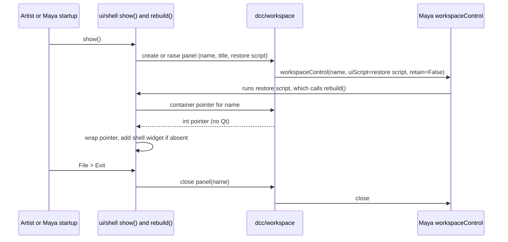

# Application Shell - Plan

## Goal Capsule

- **Objective:** Artists have one persistent mise-stage panel in Maya 2026+ that docks beside the tools they already use, such as a tab over the Attribute Editor, or floats as its own window, so later tabs have a frame to live in.
- **Means:** A Maya workspace panel whose Qt content is built by a guarded restore script (KTD2).
- **Product authority:** The Product Contract wins on behavior; a KTD wins on implementation mechanism; a unit overrides neither. This plan covers the empty shell and its docking behavior only; tabs, install tooling and Maya menu or shelf entry points are not active scope.
- **Execution profile:** Code, on branch `15-application-shell`, landing as a PR containing `Closes #15`. The deferred installation/deployment work is tracked in #16. Start with the hands-on Maya check in U1; tests for the restore-script builder are written alongside U2.
- **Stop conditions:** Stop and ask if U1 shows Maya cannot both remember the panel's position after Exit (R3) and leave it closed after a restart (R6), since the Product Contract requires both.
- **Who finishes:** `ce-work` implements and verifies, then opens the PR with the AE1 to AE6 checklist (Verification Contract).
- **Open blockers:** None.

Product Contract preservation: unchanged.

---

## Product Contract

### Summary

An empty "Mise Stage" panel for Maya 2026+ (PySide6) with a menu bar holding one File ▸ Exit action. It is a native Maya dockable panel: it tabs or splits into any dock area, including over the Attribute Editor, or floats. A documented Python call, `mise_stage.ui.shell.show()`, opens it, and Maya reopens it where it was left on the next launch.

### Problem Frame

Cameras, shots and renders will be managed through tabs inside one mise-stage panel. Artists work with Maya's Attribute Editor, Outliner and viewport open, so the panel has to dock into that layout and survive Maya restarts the way built-in panels do. None of that can be added later without reworking the frame, so the frame comes first.

### Key Decisions

- **The shell is a Maya workspace panel, not a free-floating Qt window.** Docking, floating and restore are Maya's own behavior and match the Attribute Editor. Governs R1, R2, R6. (session-settled: user-directed — chosen over a plain parented window: user wants it dockable as a tab over the Attribute Editor.)
- **Opens from a Python call only.** No Maya menu item or shelf button ships yet, and there is no top-level alias for the call. Governs R4. (session-settled: user-directed — chosen over a shipped menu item or shelf button: smallest scope for the first version.)
- **Restore on startup is in, install tooling is out.** Restore needs `python/` on Maya's `sys.path` at startup; this plan documents that requirement and leaves putting it there to a separate installation/deployment piece of work (probably a Maya module file). Governs R6, R7. (session-settled: user-directed — chosen over shipping a module file now or dropping restore: user wants restore and a separate install discussion.)
- **Exit closes the panel and never quits Maya.** The panel is one workspace member, not the application. Exit counts as deliberately closing it, so it does not return on the next Maya start. Governs R3, R6. (session-settled: user-approved — proposed with Maya's tab-close behavior shown as the model.)
- **Single instance.** Opening an already open panel brings it forward. Governs R5.
- **A failed restore leaves an empty tab and one warning, not a traceback.** Once Maya recreates the tab, mise-stage cannot make a missing import silent; the guarded restore script prints a one-line Script Editor warning instead. Governs R7. (session-settled: user-approved — proposed with the alternative that a fully silent restore is outside our control.)
- **The `dcc/` and `ui/shell/` seam is a plain pointer.** `dcc/` creates and closes the panel and returns the container's raw pointer as an int, with no Qt imports. `ui/shell/` wraps it and parents the shell into it. `dcc/` takes the dotted path of the `ui/shell` rebuild function as a string and composes the guarded restore script, so it never imports `ui/`. Governs R7, R9. (session-settled: user-approved — proposed as the only split that satisfies "no Qt in `dcc/`, no Maya calls from views".)
- **Maya's per-workspace layout is accepted.** A panel docked in one Maya workspace does not appear in another until opened there. Governs R2, R10. (session-settled: user-approved — chosen over making the panel follow the artist across workspaces, which fights Maya's layout system.)

### Requirements

**Panel**

- R1. The shell is a panel titled "Mise Stage" that the artist can dock into any Maya dock area, including as a tab over the Attribute Editor, and can float as a separate window.
- R2. Dock position, size and floating state persist through the Maya session and across normal Maya restarts.
- R3. The shell has a menu bar with a File menu containing Exit. Exit closes the panel; Maya keeps running. Reopening in the same session returns the panel to its last position.
- R4. The shell opens from `mise_stage.ui.shell.show()`, usable from the Script Editor or a shelf button the artist makes.
- R5. Calling `show()` when the panel already exists shows and raises it; it does not create a second panel.
- R6. When Maya starts with the panel left open last session, it is rebuilt in its last position. A panel closed with Exit is not rebuilt.
- R7. If the `mise_stage` package cannot be imported when Maya restores the panel, no traceback is printed. The tab is present but empty, and one Script Editor line says `python/` must be on `sys.path`.

**Content and structure**

- R8. The shell body is a blank placeholder area with no tab widget; tabs are added by later work.
- R9. Code follows the three-layer rule in `AGENTS.md` and the seam in the Key Decisions: the Qt shell (model, view, controller) in `python/mise_stage/ui/shell/`, and Maya workspace-panel creation in `python/mise_stage/dcc/`. Exit calls back through `dcc/`, never `maya.cmds` from a view.
- R10. A technical doc for the shell is added under `docs/technical/` and linked from `docs/technical/README.md`. It covers `show()`, the `sys.path` requirement for restore (R7), the per-workspace behavior, and the manual steps for reloading modules during development (close the panel, reload the modules, call `show()`). It defines "shell" and "panel" there; `GLOSSARY.md` is unchanged.

### Acceptance Examples

- AE1. **Covers R1, R2.** Given the panel is open, when the artist drags it onto the Attribute Editor tab bar, it becomes a tab there; after restarting Maya it appears in the same tab group.
- AE2. **Covers R1, R2.** Given the panel is docked, when the artist floats it and moves it, restarting Maya reopens it floating at the same place.
- AE3. **Covers R3.** When the artist chooses File ▸ Exit, the panel closes and Maya stays open; calling `show()` again returns it to the position it had.
- AE4. **Covers R5.** Given the panel is open as a background tab, when `show()` is called again, that tab becomes visible and no second panel appears.
- AE5. **Covers R6, R7.** Given the panel was left open and `python/` is not on `sys.path` at the next launch, Maya starts with an empty "Mise Stage" tab and one warning line, not a traceback; once the path is set, `show()` works as normal.
- AE6. **Covers R3, R6.** Given the artist closed the panel with File ▸ Exit, when Maya restarts, the panel is not rebuilt.

### Scope Boundaries

**Deferred for later**

- Installation and deployment, probably a Maya module file; tracked as its own issue.
- A Maya menu item or a shipped shelf button.
- The tab host and any tabs (cameras, shots, renders, file manager).
- Keyboard shortcuts and per-show window state.
- A development reload helper; it depends on how the package is deployed.
- A scripted `mayapy` smoke test for docking and restore; revisit when real tabs exist.

### Dependencies / Assumptions

- Maya 2026 ships PySide6 6.5.3 and `maya.app.general.mayaMixin`; both were found in the local install at `C:\Program Files\Autodesk\Maya2026`. Workspace-panel docking behavior itself has not yet been run.
- CI installs only PyYAML and does not add PySide6. The one automated test covers the `dcc/` function that builds the guarded restore script, which must import without Maya (checking that the string holds the guard and the dotted path, and compiles as Python), in `tests/test_shell*.py`.
- Docking, floating and restore are checked by hand in Maya 2026. AE1 to AE6 become a checklist in the PR description, ticked before merge.
- Maya saves layouts on a normal exit, so a crash can lose the last dock position; R2 is worded accordingly.

---

## Planning Contract

### Output Structure

```text
python/mise_stage/dcc/__init__.py
python/mise_stage/dcc/workspace.py        Maya workspace-panel adapter (maya.cmds, MQtUtil), no Qt
python/mise_stage/ui/__init__.py
python/mise_stage/ui/shell/__init__.py    show() and rebuild(), the two entry points
python/mise_stage/ui/shell/model.py       panel identity: name, title, rebuild path
python/mise_stage/ui/shell/view.py        the Qt shell: menu bar, placeholder body
python/mise_stage/ui/shell/controller.py  wires the view to dcc/, owns Exit
tests/test_shell_workspace.py
docs/technical/shell.md
```

### Key Technical Decisions

- KTD1. **The shell model owns the panel's identity.** The Maya control name, the "Mise Stage" title and the dotted path of the rebuild function live in `ui/shell/model.py` and are passed into `dcc/` as arguments, so `dcc/` never imports `ui/` (Key Decision "The `dcc/` and `ui/shell/` seam is a plain pointer"). Covers R1, R9.
- KTD2. **The restore script is a short string that imports the rebuild function inside a `try` and catches only `ImportError`.** On failure it prints one Script Editor warning that includes the exception text and says `python/` must be on `sys.path`; any other exception is allowed to surface, because a bug in the shell should not be hidden. Maya runs this string at startup, before mise-stage code exists, so the guard cannot live in a module. Covers R6, R7.
- KTD3. **The panel is created with `retain=False` and a `uiScript`, so Maya rebuilds its contents through the restore script on every restore and every reopen.** Chosen as the default over `retain=True` because the saved layout can only recreate contents by running the script. U1 confirms this against Maya 2026 and may flip it. Covers R2, R6.
- KTD4. **`show()` and `rebuild()` share one idempotent path.** `show()` creates the panel if it does not exist, otherwise calls `rebuild()` and raises it; `rebuild()` builds the shell into the panel only if no shell is there yet. This is why `show()` repairs an empty tab left by a failed restore once `python/` is on the path (AE5) without deleting the panel and losing its position. Covers R5, R7.
- KTD5. **Exit closes through `dcc/` with Maya's own close, not `deleteUI`,** unless U1 shows that `deleteUI` is the only way to keep the panel from returning after a restart. The choice depends on how Maya treats a closed panel's saved position and restore state. Covers R3, R6.
- KTD6. **Top-level package files stay free of Qt and Maya imports.** `dcc/workspace.py` imports `maya.cmds` and `MQtUtil` inside the functions that need them, and `ui/shell/__init__.py` imports the controller inside `show()` and `rebuild()`. This lets the restore-script builder be imported and tested in CI, where neither Maya nor PySide6 exists. Covers R9.
- KTD7. **The shell view is a `QMainWindow`-style widget with its menu bar and a blank central widget,** unless U1 shows Maya does not host that cleanly; a plain widget with a layout and a `QMenuBar` is the fallback. Covers R3, R8.

### High-Level Technical Design

This illustrates the intended lifecycle; names are not final.



On Maya startup only the restore script runs. If its import fails, one warning prints and the tab stays empty (R7).

---

## Implementation Units

### U1. Check Maya's panel behavior hands-on

**Goal:** Settle the unverified Maya behaviors the Product Contract leans on, before building on them.

**Requirements:** R2, R3, R6, R7; AE3, AE5, AE6.

**Dependencies:** None.

**Files:** None kept. The probe is a throwaway snippet run in the Maya 2026 Script Editor; findings are recorded in `docs/technical/shell.md` in U4.

**Approach:**
- Create a bare workspace panel with a `uiScript` that builds a label, and confirm it docks as a tab over the Attribute Editor and floats.
- Compare `retain=False` and `retain=True` across: close then reopen in the same session, and a full Maya restart (KTD3).
- Check whether Maya's close keeps the panel's last position for a later reopen, and whether a panel closed that way returns after a restart (R3, R6, KTD5).
- Check what Maya shows at startup when the `uiScript` raises an `ImportError` (R7).
- Confirm a `QMainWindow` with a menu bar renders correctly inside the panel (KTD7).
- After close and reopen with `retain=False`, check whether the previous child widgets are still alive in the container (KTD4).

**Execution note:** Throwaway exploration, not production code; delete the snippet when done and carry only the findings.

**Verification:** Each question above has a recorded answer. KTD3, KTD5 and KTD7 are confirmed or amended before U2 starts. If Maya cannot both remember position after Exit and stay closed after restart, stop and ask (Stop conditions).

### U2. Add the Maya workspace-panel adapter and the restore-script builder

**Goal:** `dcc/` can create, find, raise, close and report the pointer of a named workspace panel, and can build the guarded restore script.

**Requirements:** R6, R7, R9.

**Dependencies:** U1.

**Files:**
- `python/mise_stage/dcc/__init__.py`
- `python/mise_stage/dcc/workspace.py`
- `tests/test_shell_workspace.py`

**Approach:**
- Provide a pure function that builds the restore script from the rebuild function's dotted path (KTD2). It uses no Maya import, so it runs in CI.
- Provide the Maya-touching functions (create with `uiScript` and `retain` per KTD3, exists, raise, close, container pointer as an int), each importing Maya inside the function (KTD6).
- Take every name, title and dotted path as an argument; import nothing from `ui/` (KTD1).

**Patterns to follow:** Docstring and logging style of `python/mise_stage/config/__init__.py`; test layout of `tests/test_config.py` (path insert, `unittest`).

**Test scenarios:**
- Covers AE5. The built script, run with a stub `maya.cmds` and a missing rebuild module, prints one warning containing the exception text and does not raise.
- The built script, run with a stub module on the path that records a call, calls the rebuild function exactly once.
- An `ImportError` raised inside the rebuild module's own imports is also caught and warned, not raised.
- A non-import exception raised by the rebuild function propagates and is not swallowed (KTD2).
- The built script compiles as valid Python for a representative dotted path, and contains that path.
- `import mise_stage.dcc.workspace` succeeds in an interpreter with no `maya` package (KTD6).

**Verification:** `tests/test_shell_workspace.py` passes outside Maya; the adapter's Maya functions are exercised in U3's hand checks.

### U3. Build the Qt shell and the open and rebuild entry points

**Goal:** `mise_stage.ui.shell.show()` opens the "Mise Stage" panel with a File ▸ Exit menu and a blank body, and `rebuild()` fills a restored panel.

**Requirements:** R1, R3, R4, R5, R6, R8, R9; AE1, AE2, AE3, AE4, AE5, AE6.

**Dependencies:** U2.

**Files:**
- `python/mise_stage/ui/__init__.py`
- `python/mise_stage/ui/shell/__init__.py`
- `python/mise_stage/ui/shell/model.py`
- `python/mise_stage/ui/shell/view.py`
- `python/mise_stage/ui/shell/controller.py`

**Approach:**
- `model.py` holds the control name, the title and the rebuild function's dotted path (KTD1). It has no behavior to test.
- `view.py` builds the shell widget: a File menu with Exit and a blank central area (R8, KTD7). It contains no Maya calls.
- `controller.py` follows KTD4: `show()` creates the panel through `dcc/` if absent, otherwise rebuilds and raises it; `rebuild()` obtains the container pointer from `dcc/`, wraps it with shiboken, and adds the shell only if the live container has no child with the shell's object name. The test inspects the container, not the controller's Python reference, which can point at a widget Maya already deleted. Exit calls `dcc/` close (KTD5). The controller keeps a reference to the shell so it is not garbage collected, and replaces it on every rebuild.
- `ui/shell/__init__.py` exposes only `show` and `rebuild` and imports the controller inside them (KTD6).

**Technical design:** Directional only; see the sequence diagram above.

**Test scenarios:** Test expectation: none -- Qt and Maya behavior cannot run in CI (no PySide6, no Maya); this unit is proven by the hand checks below.

**Verification:** In Maya 2026, every acceptance example passes: AE1 (dock as tab over Attribute Editor, survives restart), AE2 (floating position survives restart), AE3 (Exit closes, `show()` returns it to its last spot), AE4 (second `show()` raises, no duplicate), AE5 (no `python/` on path: one warning, empty tab; repaired once the path is set and `show()` is called), AE6 (Exit then restart: not rebuilt).

### U4. Document the shell and update the layout notes

**Goal:** A reader can open the shell, understand restore and its `sys.path` requirement, and reload modules during development.

**Requirements:** R7, R10.

**Dependencies:** U3.

**Files:**
- `docs/technical/shell.md`
- `docs/technical/README.md`
- `README.md`

**Approach:**
- `docs/technical/shell.md`: the `show()` call as a runnable example, the `sys.path` requirement for restore and the one-line warning (R7), Maya's per-workspace layout, the manual reload steps (close the panel, reload the modules, call `show()`), the Maya behavior findings from U1, and definitions of "shell" and "panel".
- Link the new doc from `docs/technical/README.md`.
- In `README.md`, replace the "not created yet" wording for `dcc/` and `ui/` with their current contents and add the two new package lines to the layout block.

**Patterns to follow:** `docs/technical/config.md` for tone and example style; the docs rule that examples must run as written.

**Test scenarios:** Test expectation: none -- documentation only; the code sample is checked by running it in Maya in U3.

**Verification:** `docs/technical/shell.md` exists, is linked from `docs/technical/README.md`, and its example matches the shipped `show()` call. `GLOSSARY.md` is unchanged (R10).

---

## Verification Contract

| Check | How | When |
|---|---|---|
| Unit tests | `python -m unittest discover -s tests` (locally with the `mise-py311` venv's Python); CI runs it on Windows and Ubuntu | After U2, and before the PR |
| Docking, floating, restore | Hand-run AE1 to AE6 in Maya 2026; tick each in the PR description | After U3, before merge |
| Docs example | Run the `show()` example from `docs/technical/shell.md` in Maya | After U4 |

## Definition of Done

- All six acceptance examples pass in Maya 2026 and are ticked in the PR description.
- `tests/test_shell_workspace.py` passes locally and in CI.
- `docs/technical/shell.md` and the README layout block are in place and accurate.
- The U1 probe snippet is deleted and nothing from it is left in the diff.
- No Qt import exists under `dcc/` or `backends/`, and no `maya.cmds` call exists in `ui/shell/view.py`.

---

## Planning Scope Boundaries

**Considered and not built**

- A custom wrapper that re-implements Maya's docking: Maya's workspace panel already provides it. Revisit if U1 shows the native panel cannot host the shell.
- `MayaQWidgetDockableMixin` from `maya.app.general.mayaMixin`: it calls `maya.cmds` from the widget, which the `ui/` layer rule forbids. Revisit only if the layer rule changes.
- Extra recovery for a corrupt saved layout: Maya owns that file, and a bad restore already degrades to an empty tab with a warning (R7).

## Risks & Dependencies

- **Unverified Maya behavior (high impact).** Remembering position after Exit, and not returning after a restart, are assumed from documentation and forum reports. U1 resolves this first, and the Stop conditions send the plan back to you if both cannot hold.
- **Qt object lifetime.** The shell widget must be kept alive by the controller or Maya may free it while the panel is open; AE1 to AE4 cover this in the hand checks.
- **Restore runs before our code.** Maya recreates the panel and runs the saved script at startup, so the script string, not mise-stage code, must carry the guard (KTD2).
- **No CI coverage for the shell.** Only the restore-script builder is automated; regressions in docking, Exit or restore show up only in a hand check (accepted in the Product Contract).

## Sources & Research

- `C:\Program Files\Autodesk\Maya2026\Python\Lib\site-packages\maya\app\general\mayaMixin.py` shows Maya's own workspace-panel pattern: `cmds.workspaceControl(...)` with `retain` and `uiScript`, `MQtUtil.findControl` and `getCurrentParent`, and shiboken `wrapInstance`.
- Maya SDK, "Writing Workspace controls": the `uiScript` string runs on every restore, everything it calls must be importable at startup, and the control already exists when the script runs.
- Existing patterns: `python/mise_stage/config/__init__.py` (module docstring and logging), `tests/test_config.py` (test layout and `sys.path` setup), and the layer rules in `.github/copilot-instructions.md`.
