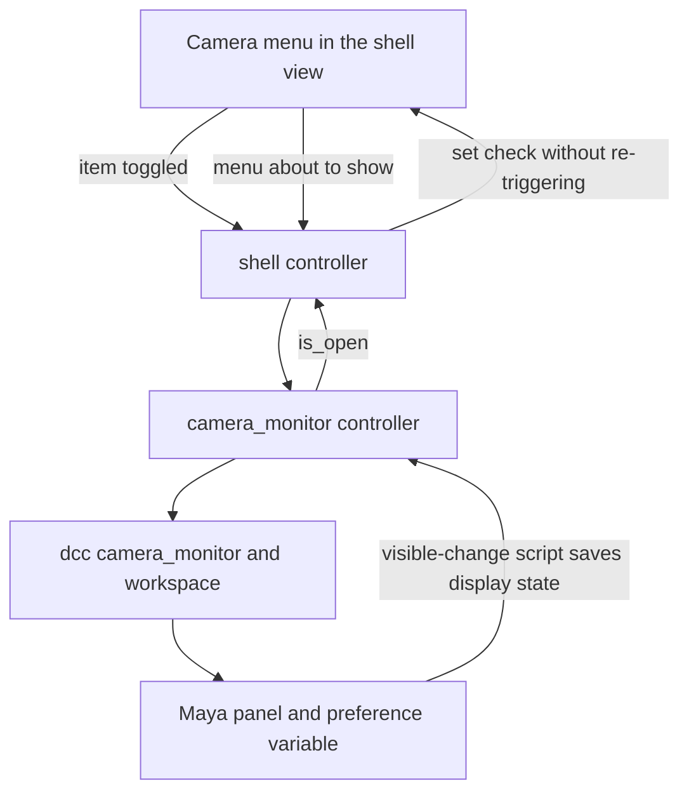
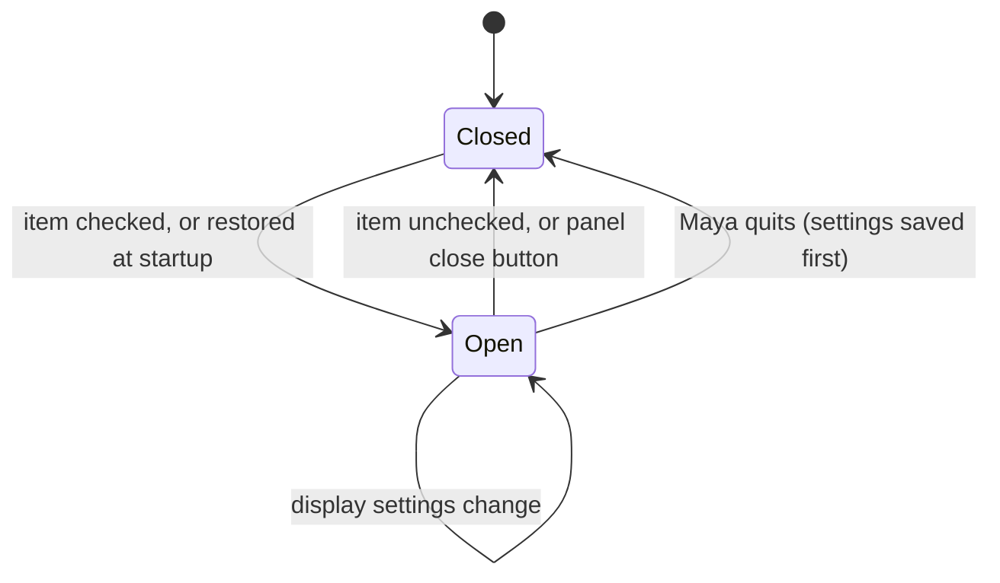

# Camera Monitor - Plan

## Goal Capsule

- **Objective:** Artists have a view-only camera monitor in Maya that shows persp with shading and lighting of its own, so the panel, its menu entry and its settings exist before the Active camera concept does and later work can use those settings for renders.
- **Means:** A Maya workspace panel holding a model panel, built and restored the way the shell is, with its input blocked by a Qt event filter and opened from a checkable Camera menu on the Mise Stage shell (KTD1, KTD3, KTD6).
- **Product authority:** The Product Contract wins on behavior; a KTD wins on implementation mechanism; a unit overrides neither. This plan covers the monitor panel, its menu entry and its interim settings storage only. The Active camera concept, the render link, a layout-pane version, embedding in the shell window and the permanent home for settings (#20, #21) are not active scope.
- **Execution profile:** Code, on branch `22-camera-monitor`, landing as a PR containing `Closes #22`. Start with U1, the hands-on Maya check, before writing any code. Maya behavior is checked by hand against AE1 to AE6 and the PR carries that checklist; CI covers only the pure Python pieces, and a local headless `mayapy` smoke test covers the Qt pieces (Verification Contract).
- **Stop conditions:** Stop and ask if U1 shows Maya cannot lock out camera movement and selection (R7), hold the monitor to its role (R8), show its standard panel menus (R5) in this panel, or open it floating and rebuild it in place (R1, R2), since the Product Contract requires all four.
- **Who finishes:** `ce-work` implements and verifies, then opens the PR with the AE1 to AE6 checklist.
- **Open blockers:** None.

Product Contract preservation: restructured, no scope change: R12 reworded so the Qt code that blocks camera input sits in `ui/camera_monitor/` rather than in `dcc/`, because `dcc/` may not import Qt. Its "no `backends/` part" and test locations are unchanged; all other requirements and IDs are unchanged.

---

## Product Contract

### Summary

A "Camera Monitor" panel for Maya 2026+. It floats or tabs beside the Attribute Editor or the Mise Stage panel, looks through persp, and is view-only. Its shading and lighting are its own, are changed through Maya's standard panel menus, and persist across restarts. A new Camera menu on the shell's menu bar has a checkable Camera Monitor item that opens and closes it.

### Problem Frame

Mise is moving toward one camera that the artist works through, and the shading and lighting of that view will eventually drive renders. Today the only way to see a camera is to switch a working viewport to it, which disturbs the stock persp, side and top views. A separate monitor keeps those views alone and gives the render-oriented display settings a home of their own.

The monitor ships first with persp alone, looking through it directly, so for now it is effectively a second persp view with independent shading and lighting. It becomes distinct from persp when the Active camera arrives. Building the panel, menu entry and settings first means that later change is a swap of the camera, not a new feature.

### Key Decisions

- **The monitor is its own Maya workspace panel, not part of the shell window.** Maya docks and restores it like any panel. Governs R1, R2. (session-settled: user-directed — chosen over embedding it in the shell body and over a pane in Maya's view layout: in Maya 2026 a model panel built in one place and moved into a Qt window stayed blank, while a workspace panel docked and floated correctly.)
- **The monitor looks through the camera directly.** Mise adds no camera or constraint to the scene. Governs R4. (session-settled: user-directed — chosen over a follower camera: the follower gives the monitor its own lens but puts extra nodes in every scene.)
- **Shading and lighting are changed through Maya's own panel menus.** Governs R5. (session-settled: user-directed — chosen over no controls and over Mise-built controls: familiar controls now, Mise's own settings UI later.)
- **The monitor is view-only at first.** An option to allow tumble and dolly may come later. Governs R7. (session-settled: user-directed — chosen over a navigable monitor.)
- **The monitor stays a camera monitor showing persp.** Maya's camera-changing, panel-swapping and tear-off items must not change it. Governs R8. (session-settled: user-directed — chosen over letting the artist point it at any camera.)
- **The Camera menu item is a check mark for "monitor is open".** Governs R9, R10, R11. (session-settled: user-approved — proposed with the check state following the panel's real state.)
- **Display settings persist, stored in Maya's own preferences for now.** The permanent home is decided with the user settings system (#20) and the scene settings system (#21), and the stored values then move there. Governs R6. (session-settled: user-approved — chosen over resetting to the default on every rebuild, which silently loses the look set before a restart, and over storing them in Mise's per-show settings, which are for values shared across a production.)
- **The monitor first opens floating, like the shell, and File ▸ Exit on the shell closes only the shell.** Governs R1, R3. (session-settled: user-approved — proposed for consistency with the shell.)

### Requirements

**Panel**

- R1. The camera monitor is a panel titled "Camera Monitor" that first opens floating, and that the artist can float, or dock as a tab beside the Attribute Editor, the Mise Stage panel or any other Maya panel.
- R2. Its dock position, size and floating state persist across Maya restarts. A monitor left open at exit is rebuilt in place; one the artist closed stays closed.
- R3. File ▸ Exit on the shell closes only the shell; an open monitor stays open.

**Camera and display**

- R4. The monitor shows the view through persp, and Mise adds no camera, constraint or other node to the scene to do it.
- R5. The monitor's shading and lighting settings belong to it alone: changing them does not change any other view, and changing another view does not change them. It opens with Maya's default new-panel look (smooth shaded, default lighting), and the artist changes it with Maya's standard panel menus.
- R6. The shading and lighting the artist sets persist across closing and reopening the monitor and across Maya restarts, stored in Maya's own preferences until #20 and #21 provide a permanent home.
- R7. The monitor is view-only: the artist cannot move a camera through it by mouse or by shortcut (for example F to frame the selection), and clicking in it selects nothing and shows no manipulators. Selection made elsewhere still shows highlighted in it.
- R8. Maya's panel menus and controls cannot make the monitor show a different camera, turn it into a different panel, or create a copy of it.

**Camera menu**

- R9. The shell's menu bar has a Camera menu containing a checkable "Camera Monitor" item.
- R10. Checking the item opens the monitor, or raises it if it already exists; it never creates a second one. Unchecking closes it.
- R11. The item's check state matches whether the monitor is open at all times, including after the artist closes the monitor with its own close button and after a restart restores it.

**Structure**

- R12. All Maya calls, including panel creation, camera binding, menu trimming and preference storage, live in `python/mise_stage/dcc/` in a new camera-monitor module. Qt code, including whatever blocks camera input, lives in a new `python/mise_stage/ui/camera_monitor/` element. The Camera menu and its check state live in `python/mise_stage/ui/shell/`. There is no `backends/` part. Tests go in `tests/test_camera_monitor*.py`, with the shell menu covered by the existing shell tests.
- R13. A technical doc, `docs/technical/camera-monitor.md`, is added and linked from `docs/technical/README.md`. It covers opening the monitor, the `sys.path` requirement for restore, where the display settings are stored for now, and the manual steps for reloading modules during development.

### Acceptance Examples

The open-and-close behavior is a single toggle, so there is no separate flow section; these examples cover it.

- AE1. **Covers R1, R2.** Given the monitor opens for the first time, it floats. When the artist drags it onto the Attribute Editor tab bar, it becomes a tab there; after restarting Maya it appears in the same tab group.
- AE2. **Covers R9, R10, R11.** Given the monitor is closed and the Camera Monitor item is unchecked, when the artist checks it, the monitor opens and the item is checked. When the artist then closes the monitor with its own close button, the item becomes unchecked.
- AE3. **Covers R4, R5.** Given the monitor is open next to the persp view, when the artist sets the monitor to wireframe with all lights, the persp view's shading and lighting do not change.
- AE4. **Covers R7, R8.** When the artist drags in the monitor with the tumble or dolly tool, presses F, or clicks an object, nothing moves, nothing is selected and no manipulator appears. No item in the monitor's panel menus can make it show another camera, become another panel or make a copy.
- AE5. **Covers R6.** Given the artist set the monitor to wireframe, when they close and reopen it, or restart Maya, it shows wireframe.
- AE6. **Covers R3.** Given the monitor is open, when the artist chooses File ▸ Exit on the shell, the shell closes and the monitor stays open.

### Scope Boundaries

**Deferred for later**

- The Active camera concept, and the monitor following it instead of persp.
- Using the monitor's shading and lighting for renders.
- The permanent home for the stored display settings, and moving them there: user settings (#20) and scene settings (#21).
- Showing the monitor as a pane in Maya's view layout alongside persp, side and top.
- An option that allows tumble and dolly in the monitor.
- Mise-built shading and lighting controls.
- Embedding the monitor inside the Mise Stage shell window. Not possible with the approaches tried in Maya 2026.
- Opening the monitor with the shell closed. The Camera menu lives on the shell, so the monitor is opened from there.

**Considered and not built**

- Pushing panel visibility changes to the Camera menu through a signal. The check is refreshed when the menu opens, which looks the same to the artist without a notifier; revisit if a menu ever shows the state continuously.

### Dependencies / Assumptions

- **Restore at startup** works like the shell's (R2): it needs `python/` on Maya's `sys.path`, as documented in `docs/technical/shell.md`.
- **Unverified in Maya, checked first in U1:** that camera movement, shortcuts and selection can be locked out cleanly (R7), that camera-changing, panel-swapping and tear-off items can be hidden or reversed (R8), that Maya's standard panel menus appear in a model panel inside a workspace panel (R5), that the monitor's open state can be read reliably when the Camera menu opens (R11), and that the stored settings can be reapplied to a rebuilt panel (R6).
- **Verified in a throwaway spike in Maya 2026:** a model panel inside a workspace panel floats and docks as a tab; its shading and lighting stay independent of the stock persp panel; a panel looking through persp stays in step with the other persp view, updating when a drag ends.
- **Follow-up work:** #20 (user settings system) and #21 (scene settings system).

### Outstanding Questions

**Deferred to Implementation**

- Which of the U1 mechanisms work as planned, and which named fallback applies to any that do not.
- The exact Maya menu items to remove or disable, and the preference variable name.

### Sources / Research

- `docs/technical/shell.md`: how the shell panel is built, restored and documented.
- `python/mise_stage/dcc/workspace.py`: the existing panel create, raise, close and restore-script helpers.
- `python/mise_stage/ui/shell/`: the shell's view, controller and model that the monitor and its menu follow.
- `docs/solutions/developer-experience/headless-maya-qt-smoke-tests-with-mayapy.md`: how to smoke-test Qt views and controllers without the Maya GUI.
- Autodesk's Maya command reference for `modelPanel`, `modelEditor` and `workspaceControl`: documents a panel menu-bar flag and visible-change and close callbacks. It documents no way to lock viewport navigation, which is why KTD3 uses a Qt event filter.
- A throwaway Maya 2026 spike, kept locally and not committed under `.context/compound-engineering/ce-prototype/2026-10-26-camera-monitor-hosting/`; its findings are carried in the Key Decisions above. It also showed that a panel name left behind by a failed build makes the next build fail, which KTD2 handles.

---

## Planning Contract

### Key Technical Decisions

- KTD1. **The monitor is created and restored through the shell's existing workspace-panel helpers.** `dcc/workspace.py` creates it floating with a restore script that calls the monitor controller's rebuild function, and gains an optional visible-change script and a visibility query. Governs R1, R2. (session-settled: user-directed — chosen over embedding it in the shell body and over a pane in Maya's view layout: in Maya 2026 a model panel built in one place and moved into a Qt window stayed blank.)
- KTD2. **The panel is a single-pane layout holding one model panel, bound to persp by name, with its menu bar shown.** Any panel left over under the same name is removed before each build, so a failed or repeated build cannot collide with it. Governs R4, R5, R8.
- KTD3. **Camera input is blocked by a Qt event filter on the monitor's viewport widget, and the viewport takes no keyboard focus.** `dcc/` finds the widget and returns its pointer as a plain integer, as the shell does for its container; `ui/camera_monitor/` wraps it and installs the filter. Governs R7. Maya documents no navigation switch, and locking persp's own attributes would lock the artist's working camera. U1 confirms the filter stops tumble, track, dolly, wheel, clicks and camera shortcuts; if it cannot, the Stop condition applies.
- KTD4. **The monitor is held to its role by trimming its own menus.** U1 identifies the camera-changing, panel-swapping and tear-off items to remove or disable. If an item cannot be removed, the fallback is to put persp back whenever the monitor's camera changes; that fallback is designed only if U1 needs it. Governs R8.
- KTD5. **The monitor's display state is saved as Maya's editor state string in one preference variable, and reapplied after each build.** It is saved when the monitor's visibility changes and when Maya quits. This keeps other display toggles such as the grid, because Maya has no shading-and-lighting-only snapshot. If the string does not restore faithfully, the fallback is an explicit list of shading and lighting properties held in a small pure-Python module. Governs R5, R6.
- KTD6. **The check state is refreshed from the monitor's real state each time the Camera menu is about to show.** The shell view emits a signal when the menu is about to show, and the shell controller sets the check from the monitor's `is_open` without triggering the toggle. This keeps the check right after the close button, floating, docking and a restart, and it does not depend on Maya's callbacks. The visible-change script stays, but only to save display state (KTD5). Governs R9, R10, R11.
- KTD7. **Layers follow `AGENTS.md`.** `dcc/` never imports `ui/`; the restore and visible-change scripts name the monitor controller by dotted-path string, as the shell's do. `ui/shell/` imports the public functions of `ui/camera_monitor/`. Governs R12.

### High-Level Technical Design

How the Camera menu opens and closes the monitor, how its check is refreshed, and how a Maya-side close is saved:

The monitor's lifecycle, which the menu check mirrors:

### Assumptions

- The U1 mechanisms (Dependencies / Assumptions in the Product Contract) work as KTD3 to KTD6 assume. U1 tests them before any code is written.
- A panel built inside the workspace panel is restored by Maya re-running the restore script, as for the shell, so the build must be safe to run twice (KTD2).

---

## Implementation Units

### U1. Verify the unproven Maya mechanisms

- **Goal:** Learn, before any code is written, which of the planned Maya mechanisms work in Maya 2026.
- **Requirements:** R1, R2, R5, R6, R7, R8, R11.
- **Dependencies:** None.
- **Files:** None committed. Use scratch scripts outside `python/` and `tests/`.
- **Approach:** Run each check in the Maya GUI and note the result; the results feed U2 to U5 and the technical doc.
  1. A model panel inside a workspace panel can show its standard menu bar, and which menus appear.
  2. Which items in those menus change the camera, swap the panel type or tear off a copy, and whether each can be removed or disabled from the panel's menu bar. Also check whether the camera can change by another route, such as a hotkey or Look Through Selected.
  3. A Qt event filter on the viewport widget, found through the panel's Qt container, stops Alt-drag tumble, track and dolly, the mouse wheel, clicks and marquee selection, and F and other camera shortcuts, while Maya's menus and the other views keep working. Also check the effect of removing keyboard focus from the viewport.
  4. Whether the visible-change and close callbacks fire when the tab's close button is pressed, when the panel is floated or docked, when the Maya workspace changes, when Maya restores the panel at startup, and when Maya quits, and whether the callback must be re-attached after a restore.
  5. Whether the editor state string reapplies faithfully (wireframe, all lights, shadows) to a rebuilt panel, whether it can still be read from the visible-change callback at the moment the panel closes (before Maya destroys the contents), whether a quit-time script job can still read the live panel, and whether a preference variable written there survives a normal restart.
  6. That the first open floats, and that Maya re-running the restore script on reopen builds the panel only once.
- **Execution note:** Do this first. If checks 1 to 3 fail, stop and ask under the Goal Capsule's stop conditions. If check 6 shows the first open cannot float or the panel cannot be rebuilt in place, stop and ask, since R1 and R2 cannot be met. A failure in check 4 only loses the save when the monitor closes, so the display state is saved at Maya quit alone; R11 does not depend on the callbacks (KTD6). A failure in check 5 uses the property-list fallback in KTD5. Each outcome is recorded in the technical doc.
- **Test expectation:** none -- a hands-on check; no production code lands in this unit.
- **Verification:** Each check has a recorded yes or no, and every no has either a fallback or a stop-and-ask.

### U2. Maya adapter for the monitor panel

- **Goal:** Provide the Maya-side functions the monitor needs, with no Qt and no import of `ui/`.
- **Requirements:** R1, R2, R4, R5, R6, R8, R12.
- **Dependencies:** U1.
- **Files:** `python/mise_stage/dcc/camera_monitor.py` (new), `python/mise_stage/dcc/workspace.py`, `tests/test_camera_monitor_dcc.py` (new).
- **Approach:** Governed by KTD1, KTD2, KTD4 and KTD5.
  1. Add to `workspace.py` an optional visible-change script on `create`, an edit helper that sets it on an existing control (the monitor's `rebuild` calls it, because Maya restores the panel by re-running the restore script rather than `create`), a visibility query, and a pure helper that builds the guarded visible-change script from a dotted path, like `restore_script`. Existing shell calls keep working unchanged.
  2. In the new module, add a function that builds the panel content, removing any stale panel of the same name first, binding persp and showing the menu bar, then applying the trimmed menus U1 identified.
  3. Add functions to save and apply the editor state string through one preference variable, and to register the quit-time save. Registration is idempotent, so repeated rebuilds leave exactly one script job.
  4. Add a function that returns the viewport widget's pointer as an integer (KTD3).
  5. Defer every `maya` import into the functions that use it.
- **Patterns to follow:** `python/mise_stage/dcc/workspace.py` for deferred Maya imports and the integer-pointer seam.
- **Test scenarios:**
  - Importing `mise_stage.dcc.camera_monitor` with no Maya installed succeeds, and importing it does not import PySide6.
  - The visible-change script built for a controller path compiles and names the function it calls.
  - Run with the package missing, the visible-change script warns once and does not raise, and with the package present it calls the function once (mirrors the restore-script tests).
  - Test expectation for the Maya calls themselves: none -- they run only inside Maya and are covered by AE1, AE3, AE4 and AE5 by hand.
- **Verification:** The new module and the helper import and test outside Maya; in Maya the panel builds looking through persp, shows trimmed menus, and its state round-trips.

### U3. The camera monitor UI element

- **Goal:** Open, close and rebuild the monitor, block its input, and report whether it is open to the rest of the UI.
- **Requirements:** R1, R2, R7, R10, R11, R12.
- **Dependencies:** U2.
- **Files:** `python/mise_stage/ui/camera_monitor/__init__.py`, `model.py`, `view.py`, `controller.py` (all new), `tests/test_camera_monitor_model.py` (new).
- **Approach:** Governed by KTD1, KTD3, KTD6 and KTD7, following the shell's element layout.
  1. `model.py` holds the title, the workspace control name, the panel name, the preference variable name and the dotted rebuild path, as plain values.
  2. `controller.py` has `show`, `hide`, `is_open` and `rebuild`. `rebuild` is safe to run twice: it builds the panel only when it is absent, applies the saved state, and installs the input blocker only once.
  3. `controller.py` also owns the function the visible-change script calls, which saves the display state.
  4. `view.py` holds the event filter that swallows mouse, wheel and key input on the viewport and lets paint and resize through.
  5. `__init__.py` exposes `show`, `hide`, `is_open` and `rebuild` lazily, importing Qt and Maya only inside the functions, like `ui/shell/__init__.py`.
- **Patterns to follow:** `python/mise_stage/ui/shell/` (model, view, controller, lazy package functions) and its `rebuild()` idempotence.
- **Test scenarios:**
  - The monitor's control name, panel name and preference variable name differ from the shell's, so the two panels never collide.
  - The rebuild path names the controller's `rebuild`, not a lazy package function, so loading Qt happens inside the restore script's guard.
  - Importing `mise_stage.ui.camera_monitor` with no Maya and no Qt installed succeeds.
  - Headless smoke, run locally and not in CI: the input blocker swallows mouse press, move, wheel and key events on a plain widget and passes paint and resize events through.
  - Headless smoke: installing the blocker twice leaves one filter in place.
- **Verification:** Package and model tests pass in CI; in Maya the monitor opens floating, rebuilds in place after a restart, blocks tumble, dolly, clicks and F, and reports whether it is open.

### U4. Camera menu on the shell

- **Goal:** Add the Camera menu and its checkable item, wired to the monitor.
- **Requirements:** R3, R9, R10, R11.
- **Dependencies:** U3.
- **Files:** `python/mise_stage/ui/shell/view.py`, `python/mise_stage/ui/shell/controller.py`, `python/mise_stage/ui/shell/model.py` if a label constant is needed.
- **Approach:** Governed by KTD6 and KTD7.
  1. The view creates the Camera menu with an explicit parent, as the File menu is, adds a checkable Camera Monitor item, and emits a toggled signal for it and a signal when the menu is about to show. A setter changes the check state without emitting.
  2. The controller connects the toggled signal to the monitor's `show` and `hide`, and on the about-to-show signal sets the check from the monitor's `is_open`.
  3. File ▸ Exit stays as it is: it closes the shell only.
- **Patterns to follow:** `exit_requested` and the explicit-parent `QMenu` in `python/mise_stage/ui/shell/view.py`; the gotcha in `docs/solutions/developer-experience/headless-maya-qt-smoke-tests-with-mayapy.md`.
- **Test scenarios:**
  - Covers AE2. Headless smoke, run locally: checking the item calls the monitor's `show`, and unchecking calls `hide`.
  - Covers AE2. Headless smoke: showing the menu with the monitor reported closed leaves the item unchecked without calling `hide`, and showing it with the monitor reported open checks the item without calling `show`.
  - Covers AE6. Headless smoke: choosing File ▸ Exit emits only the shell's exit request and does not call the monitor's `hide`.
  - Test expectation for CI: none -- these need PySide6, which CI does not install; the Verification Contract runs them locally.
- **Verification:** In Maya, the Camera menu appears on the shell, opens and closes the monitor, and the check follows it, including after the monitor's own close button.

### U5. Technical doc and links

- **Goal:** Document the monitor and update the places that describe the shell and the layout.
- **Requirements:** R13.
- **Dependencies:** U1, U2, U3, U4.
- **Files:** `docs/technical/camera-monitor.md` (new), `docs/technical/README.md`, `docs/technical/shell.md`, `README.md`.
- **Approach:**
  1. The new doc covers opening the monitor, the `sys.path` requirement for restore, what is stored and where for now, the U1 results and any fallback taken, and the manual module-reload steps.
  2. Link it from `docs/technical/README.md`; add the Camera menu to the description in `docs/technical/shell.md`; add `ui/camera_monitor/` to the layout list in `README.md`.
  3. Check every code sample in the new doc against the final API.
- **Patterns to follow:** `docs/technical/shell.md` for structure and tone.
- **Test expectation:** none -- documentation only; code samples are checked by hand against the API.
- **Verification:** The doc links resolve and the samples run as written in Maya.

---

## Verification Contract

| Check | Command or procedure | Covers |
|---|---|---|
| Pure Python tests | `python -m unittest discover -s tests` (CI runs this on Windows and Ubuntu; locally use the `mise-py311` venv) | U2, U3 |
| Headless Qt smoke | A short script run with `QT_QPA_PLATFORM=offscreen` and Maya's `mayapy.exe -I`, patching the `dcc` functions the controllers call (see the mayapy smoke-test learning); not run in CI | U3, U4 |
| Hands-on in Maya 2026 | U1's checks, then AE1 to AE6, including a Maya restart for AE1 and AE5 | U1 to U4 |

The PR description carries the AE1 to AE6 checklist and the U1 results.

## Definition of Done

- All six acceptance examples pass by hand in Maya 2026, and the unit tests pass.
- U1's results are recorded in `docs/technical/camera-monitor.md`, and no stop condition is left open.
- The monitor adds no node to the scene (R4) and leaves the stock views' display settings unchanged (AE3).
- Per unit: U1 every check answered; U2 and U3 import and test outside Maya; U4 the menu follows the panel in both directions; U5 samples run as written.
- Scratch scripts and the local spike are not in the diff, and `.context/` is not committed.

---

## System-Wide Impact

- **Maya preferences.** One new preference variable holds the monitor's display state until #20 and #21 replace it.
- **Script job.** One quit-time script job is registered for the Maya session (U2).
- **Shell menu bar.** The shell gains a Camera menu; File ▸ Exit is unchanged.
- **Scene.** No node is added to any scene (R4).

---

## Risks & Dependencies

- **Unproven Maya mechanisms.** The input filter, menu trimming, callbacks and state restore are untested in Maya. U1 runs first and the Stop conditions apply.
- **Settings lost on a crash.** Settings are saved on visibility change and at quit, so a Maya crash loses changes made since the last save. Accepted until #20 and #21 provide the permanent home.
- **Per-workspace panels.** As with the shell, a monitor opened in one Maya workspace does not appear in another, so the menu check reflects the current workspace; the technical doc says so.
- **Stored state is wider than shading and lighting.** The editor state string also carries other display toggles (KTD5). Accepted; the property-list fallback narrows it if it causes trouble.
- **Restore needs `python/` on `sys.path`.** Same requirement and same single-warning behavior as the shell; install tooling stays tracked in #16.
