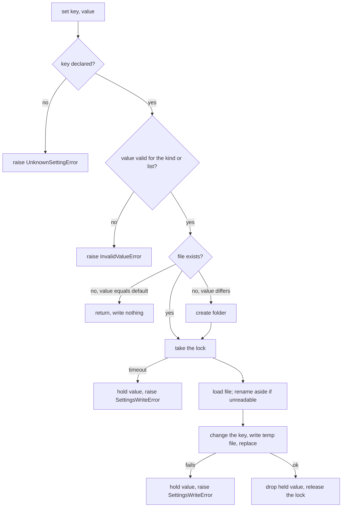

# User Settings - Plan

## Goal Capsule

- **Objective:** Artists have a place for preferences that belong to them on one machine and profile, rather than to a show or a scene, so features such as the camera manager can remember what each artist chose.
- **Means:** A flat YAML file in the operating system's per-user app-data folder, changed only under a lock file (KTD1, KTD4).
- **Product authority:** The Product Contract wins on behavior; a KTD wins on implementation mechanism; a unit overrides neither. This plan covers user settings only. Scene settings (#21), the camera manager, a settings dialog and moving the camera monitor's display state are not active scope.
- **Execution profile:** Code, continuing on branch `20-user-settings` and PR #32, whose description changes to `Closes #20` when the units land. Tests are `unittest`, run by CI on Windows and Ubuntu. Nothing runs in Maya.
- **Stop conditions:** Stop and ask if an exclusive-create lock file cannot be made to work on Windows in CI (R24).
- **Who finishes:** `ce-work` implements and verifies, then updates PR #32.
- **Open blockers:** None.

Product Contract preservation: changed: R13 (an invalid file is kept aside as `.invalid` at the next set instead of being overwritten, so hand edits survive a typo; a file that cannot be opened is not moved, and a save raises instead; an unknown key is ignored and kept because it has no default to fall back to), and R15 and R16 (the folder is created on the first save, and a value whose save failed is held for the session; these settle a contradiction between R15 and R16 that review found). AE11 is new. All other requirements and IDs are unchanged.

---

## Product Contract

### Summary

A user settings system for mise-stage. Each artist's values live in a file in their own profile folder, and each setting has a default. Settings belong to groups, and values can be on/off, a number, free text or one choice from a list. Artists can reset one group or all settings to defaults. The system ships with the camera manager's first two settings declared and no consumer.

### Problem Frame

mise-stage has one kind of setting today: per-show values read from `config/defaults.yaml` and `config/<SHOW>.yaml` (`docs/technical/config.md`). They are shared by a production and read-only at run time. Nothing stores a value that is one artist's own and must survive a restart.

The only local store is a Maya preference that the camera monitor uses privately for its display state. The camera manager is about to need preferences of its own, such as whether to confirm a camera delete. Each feature would otherwise invent its own storage.

Settings now fall into three kinds, each with its own home and no overlap: show config settings, user settings (this plan) and scene settings (#21). A setting lives in exactly one kind, so no precedence rules are needed.

### Key Decisions

- **User settings are stored in a file in the artist's profile folder.** Governs R1. (session-settled: user-directed — chosen over Maya preferences and over a per-user file on the shared drive: a plain file can be inspected and edited, does not depend on Maya, and avoids shared-drive write concerns.)
- **User settings are a separate namespace from show config settings and scene settings.** Governs R3. (session-settled: user-directed — chosen over letting a user setting override a show setting, and over letting a show lock a user setting: a setting in one place needs no precedence rules.)
- **Features change settings through Python only.** Governs R7. (session-settled: user-directed — chosen over a settings dialog on the shell and over hand-editing only.)
- **The camera monitor's display state stays in its Maya preference.** Governs R6. (session-settled: user-directed — it will most likely become a scene setting, so #21 decides its permanent home.)
- **The system ships with the camera manager's two settings and no consumer.** Governs R6. (session-settled: user-directed — chosen over shipping the system with no settings and over wiring a demo consumer.)
- **A bad file, bad value or unknown key falls back to defaults with a warning.** Governs R13. (session-settled: user-approved — chosen over raising an error as show settings do and over backing up and resetting the file: a typo in a personal file must not stop Maya tooling from starting.)
- **The code is pure Python in `backends/user_settings/`, with tests in `tests/test_user_settings*.py`.** Governs R14. (session-settled: user-approved — chosen over extending the read-only `config` module and over adding a `dcc/` adapter.)
- **A file, once created, is never removed, and nothing checks whether settings are at their defaults.** Governs R9, R10. (session-settled: user-directed.)
- **A lock file around each read-modify-write keeps two sessions from losing each other's changes.** Governs R24. (session-settled: user-directed — chosen over optimistic re-read and retry, which leaves a small window for lost updates, and over last-writer-wins, which would drop AE6.)
- **Settings use uppercase keys like show config, and each group holds the settings for what they act on.** Governs R6. (session-settled: user-directed — chosen over lowercase dotted keys. Confirm-on-delete is in Cameras and auto-open is in Camera Monitor, not together.)
- **A failed write raises instead of failing quietly, and a read goes to the file except for a value whose save failed.** Governs R15, R16. (session-settled: user-approved — chosen over a warning on write and over a session-long cache: a silent failure would let the artist think a preference was saved, and a cache would hide another session's changes.)
- **Confirm-on-delete defaults to on and auto-open defaults to off.** Governs R6. (session-settled: user-approved — a delete is hard to undo, and a panel should not open unasked.)
- **A reset removes the reset keys from the file instead of writing default values into it.** Governs R11, R12. Settings then follow later changes to the defaults. (session-settled: user-approved.)

### Requirements

**Storage and defaults**

- R1. Each artist's user settings are stored in a plain-text file in their own profile folder, local to that machine and profile. The folder is the operating system's per-user app-data folder, not Maya's preferences folder, so a Maya upgrade does not lose the settings.
- R21. The file is in the same plain-text format as the show config files, and artists may edit it by hand. The docs say how.
- R2. Every user setting has a default, used when the file or the key is missing.
- R3. A setting is a user setting, a show config setting or a scene setting, never more than one, and a user setting is not affected by show config or scene settings.
- R4. Each user setting belongs to exactly one group, such as Camera Monitor, Cameras or Rendering.
- R5. A user setting's value can be on/off, a number, free text, or one choice from a fixed list, and the setting's default decides which. A choice setting rejects any value outside its list.
- R6. The camera manager's two settings are declared, and nothing reads them yet. Each is addressed by its key alone, and a key is unique across all user settings.

  | Key | Group | Kind | Default | Meaning |
  |---|---|---|---|---|
  | `CONFIRM_CAMERA_DELETE` | Cameras | on/off | on | Ask before deleting a camera |
  | `AUTO_OPEN_CAMERA_MONITOR` | Camera Monitor | on/off | off | Open the camera monitor when a camera is activated and the monitor is closed |

**Reading and writing**

- R7. Features read and write user settings through Python. There is no settings dialog.
- R8. Setting a value writes to the file immediately and changes only that key.
- R24. Every set and every reset takes a short-lived lock beside the settings file, re-reads the file under the lock, changes only its own keys, writes, and releases the lock, so no session's change is lost. A session that cannot get the lock within a short wait raises an error per R15. The lock works on Windows and on POSIX.
- R9. The file is created the first time a setting is changed away from its default. While no file exists, setting a value equal to its default does not create one.
- R10. Once the file exists it is never removed, even when every setting is back at its default. A value set equal to its default is written like any other.
- R19. Setting a value the setting cannot hold (the wrong kind, or a choice outside its list) raises an error and writes nothing.
- R20. Reading or setting a setting that is not declared raises an error.
- R15. A set that cannot be written (the folder cannot be created, or the file is read-only or locked) raises an error naming the file. The new value is held for the rest of the session and is the value reads return (R16).
- R16. A read returns the value in the file as it is now, including a change another Maya session just made. The one exception is a value whose save failed (R15): it is returned instead of the file's value until that setting is next set or reset successfully.

**Reset**

- R11. An artist can reset one group to its defaults, which affects no other group.
- R12. An artist can reset all user settings to their defaults.
- R17. A reset when no file exists, or when the file holds none of the reset keys, does nothing and creates no file.

**Bad data**

- R13. An invalid file (not valid YAML, not UTF-8 text, or not a mapping of keys to values), a wrong-typed value, an out-of-list choice or an unknown key logs a warning. The first three fall back to the setting's default, and an unknown key, which has no default, is ignored and kept (R23). The file is not rewritten until the artist next sets a setting, and an invalid file is then renamed aside with an `.invalid` suffix instead of being overwritten. A file that exists but cannot be opened (no permission, or held by another program) also reads as defaults with a warning, but a save raises per R15 and moves nothing, because a valid file that is only briefly held must not be set aside. A warning appears once per key per Maya session.
- R23. Setting a value leaves unknown keys in the file untouched. Comments and formatting are not preserved, and the docs say so (R21).

**Placement**

- R14. The code lives in `python/mise_stage/backends/user_settings/` with no Maya or Qt import, and its tests in `tests/test_user_settings*.py`. There is no `dcc/` or `ui/` part.
- R18. `GLOSSARY.md` is updated in the same PR: "Setting" becomes "Show config setting", and "User setting" and "Group" are added.
- R22. The PR adds `docs/technical/user-settings.md`, lists it in `docs/technical/README.md` and links it from `docs/technical/config.md`.

### Acceptance Examples

- AE1. **Covers R9.** Given no settings file, when a feature sets a value equal to its default, no file is created. When it then sets a value different from the default, the file is created holding that value.
- AE2. **Covers R8, R10.** Given a file with one changed setting, when the feature sets that setting back to its default, the file remains and holds the default value, and other keys are unchanged.
- AE3. **Covers R11.** Given changed settings in the Cameras and Rendering groups, when the Cameras group is reset, the Cameras settings read their defaults and the Rendering settings keep their values.
- AE4. **Covers R12.** Given changed settings in several groups, when all are reset, every setting reads its default and the file still exists.
- AE5. **Covers R13.** Given a file that holds a text value for an on/off setting, when the setting is read, it returns the default and a warning is logged. The file is unchanged until a setting is next set.
- AE6. **Covers R8, R24.** Given two Maya sessions open, when each sets a different setting at the same moment, both values are in the file. The same holds when one session resets a group while the other sets a setting outside it.
- AE10. **Covers R24.** Given another session holds the lock past the wait, when a feature sets a setting, an error names the file and no change is written.
- AE7. **Covers R16.** Given two Maya sessions open, when one sets a setting, the other reads the new value without restarting.
- AE8. **Covers R15, R16.** Given a read-only settings folder, when a feature sets a setting, an error names the file, and a read in the same session returns the new value. When the folder later becomes writable and the setting is set again, the value is written and reads follow the file again.
- AE9. **Covers R17.** Given no settings file, when a group is reset, no file exists afterwards.
- AE11. **Covers R13.** Given a settings file with a YAML syntax error, when a feature sets a setting, the broken file is kept as `.invalid` beside it and the new file holds only the new value.

### Scope Boundaries

**Deferred for later**

- A settings dialog and any button or menu item for the reset operations.
- A way for a feature to be told when a setting changes. Features read when they need the value.
- Moving the camera monitor's display state off its Maya preference. #21 decides its home.
- Reading the camera manager settings in a feature. The camera manager itself is separate work.
- Settings that follow an artist between workstations.

**Outside this work**

- Scene settings, which are #21.
- Letting a show override or lock a user setting.
- The glossary term "Scene setting". It waits for #21.

**Considered and not built**

- A folder override through an environment variable. The store takes its folder as an argument, so tests and callers can point it anywhere, and nothing needs the variable. Evidence that would change this: a studio that must relocate the folder without code.
- A version marker or migration step in the file. The file holds flat key and value pairs, and unknown keys are kept (R23), so adding a setting needs no migration. Evidence that would change this: a setting whose stored meaning changes.
- A guard against two sessions clearing the same stale lock at once. It needs a crash plus two simultaneous sets after the stale age, and the worst result is one lost update in a personal preference file. Evidence that would change this: lock-related lost updates reported in practice.

**Deferred to Follow-Up Work**

- Extracting the retry-on-busy and atomic-replace code shared by `python/mise_stage/backends/previs_files/metadata.py` and the new store into one backend utility module. U3 keeps a small local copy so this work does not edit the previs files code.

### Dependencies / Assumptions

- Unit tests in CI are the whole verification. No Maya hand-check is needed because the code imports no Maya or Qt (R14).
- #21 is planned separately and shares the three-kind split described in the Problem Frame.
- The camera manager is not built yet, so the two settings have no reader until it is.

### Sources / Research

- `docs/technical/config.md` and `python/mise_stage/config/__init__.py`: the show config settings this plan sits beside. PyYAML is already its parser, and the CI `unittest` job installs it.
- `docs/plans/2026-10-26-1344-feat-camera-monitor-plan.md`: the monitor's interim Maya preference and its pointer to #20 and #21.
- `docs/solutions/best-practices/atomic-file-writes-preserve-shared-permissions.md`: the atomic-write guidance for the shared previs tree. KTD5 explains why its permission step does not apply here.
- `python/mise_stage/backends/previs_files/metadata.py` and `errors.py`: the existing temp-file-then-replace writer, the retry on Windows sharing errors, and the error-class convention.
- `.github/copilot-instructions.md`: backends take paths as arguments, Windows briefly refuses to open or replace a file another process is writing, and creating the thing is the lock.
- GitHub issues #20 and #21.

---

## Planning Contract

### Key Technical Decisions

- KTD1. **The settings live in `user_settings.yaml` inside a `mise-stage` folder under the operating system's per-user app-data folder, as flat `KEY: value` pairs read and written with PyYAML's safe functions.** Windows uses `%APPDATA%`, macOS uses `~/Library/Application Support`, and everything else uses `$XDG_CONFIG_HOME` or `~/.config`. A `default_directory()` function resolves it from the environment, and the store takes the folder as an argument, so tests use a temporary folder. Governs R1, R21. The group is not stored; it comes from the declarations. Chosen over JSON because the show config files are YAML and artists edit both.
- KTD2. **A setting is declared by a frozen dataclass holding its key, group, default and optional list of choices; its kind comes from the type of the default.** The kinds are `bool`, `int`, `float` and `str`. A `bool` is never accepted for an `int` or `float` setting, an `int` is accepted for a `float` setting, and a choice setting needs a default inside its list. Declaring two settings with the same key, or a default of any other type, raises when the declarations are built. The store takes the declarations as an argument and defaults to the shipped tuple holding the two camera manager settings. The module also exports each key as a constant, so the camera manager imports `CONFIRM_CAMERA_DELETE` instead of retyping the string. An unknown group passed to a reset raises an error. Governs R2, R4, R5, R6, R19, R20.
- KTD3. **One store class has four operations: read a setting, set a setting, reset a group, and reset all.** A read loads the file on every call and applies the order held value, file value, default. Governs R7, R16. The method names are directional and may change in U1 to U4 without changing the contract.
- KTD4. **The lock is a file created beside the settings file with exclusive creation, retried until a deadline.** A lock older than a stale age is treated as left behind by a crashed session and removed. It is released in a `finally`. A session that cannot get it raises a write error naming the file. The wait is about 5 seconds and the stale age about 30 seconds, held as constants that tests shorten. Governs R24. Chosen over `msvcrt` and `fcntl` locking, which differ per platform, and over re-read-and-retry, which leaves a window for lost updates. It follows the repo's rule that creating the thing is the lock (`.github/copilot-instructions.md`). (session-settled: user-directed — a lock file, per the Key Decision on locking.)
- KTD5. **Under the lock, a set loads the current mapping, changes its own keys, writes a temporary file in the same folder, and swaps it in with `os.replace`, retrying a short while on `PermissionError`.** The permission copy that `write_comment` does is left out, because the profile folder belongs to one artist and the owner-only mode `mkstemp` gives is what is wanted. The retry helper is a small local copy, not an import of the previs files module's private one. Governs R8, R10, R23. The shared-tree learning in `docs/solutions/best-practices/atomic-file-writes-preserve-shared-permissions.md` is why a plain `open` and write is not used.
- KTD11. **Reads take no lock, because a write never changes the settings file in place.** Every write builds the whole new file as a temporary file and swaps it in with `os.replace` (KTD5), so a read sees either the old file or the new one and never a half-written one. The one transient failure on Windows is `PermissionError` while the swap is under way, which a read retries (KTD5, U2) before treating the file as unreadable. Governs R13, R16, R24.
- KTD12. **A key in the file that no declaration names is ignored by reads, warned about once, and kept by every write.** It has no setting, so it has no default to fall back to. Only a value that is invalid for a declared setting (wrong kind, or a choice outside its list) reads as that setting's default. Governs R13, R23.
- KTD6. **A set whose creation rule holds writes nothing.** With no file and a value equal to the default, the set returns without creating the folder, the lock or the file. A reset with no file also returns before taking the lock; with a file, it takes the lock and decides under it which keys to remove, so a key another session adds just before the reset is removed too, and a file holding none of the keys is left unchanged. Each of these still drops any value held from a failed write for the keys involved, because the set or reset succeeded (R16). Governs R9, R16, R17.
- KTD7. **A file that cannot be parsed, or parses to something other than a mapping, reads as empty and warns once.** At the next set it is renamed to the same name plus `.invalid`, replacing an older one, and a new file is written. A reset leaves it alone. Governs R13.
- KTD8. **Warnings and failed-write values are module-level state keyed by the resolved file path and key.** "Once per key per Maya session" and "for the rest of the session" both mean the process, and features may each build their own store object. A private helper clears both, for tests. A failed-write value is dropped when that setting is next set or reset successfully. Governs R13, R15, R16.
- KTD9. **Problems raise errors that subclass one `UserSettingsError`, following the previs files convention.** `UnknownSettingError` and `UnknownGroupError` cover R20, `InvalidValueError` covers R19, and `SettingsWriteError` covers a failed write, a folder that cannot be created and a lock timeout, always naming the file. Governs R15, R19, R20, R24.
- KTD10. **The first save creates the settings folder, with parents.** A failure to create it is a write error. Governs R15.

### High-Level Technical Design

The path of one set, from the call to the file:

### Assumptions

- PyYAML is importable in Maya's Python 3.11. The Maya check recorded for the show config module (`import yaml` works in Maya) covers this, and R21 depends on it.

### Deferred to Implementation

- The exact wait and stale-age values in KTD4, and the exact method and constant names in KTD2 and KTD3.
- How the unit tests make a write fail on Windows. Patching `os.replace` or the folder creation to raise `PermissionError` works on both platforms, while changing file modes does not.

---

## Implementation Units

### U1. Declarations, value checks, errors and the two camera settings

- **Goal:** The vocabulary of the system: setting declarations, the kind check, the error classes and the two shipped settings.
- **Requirements:** R2, R4, R5, R6, R14, R19, R20 (KTD2, KTD9).
- **Dependencies:** None.
- **Files:**
  - Create `python/mise_stage/backends/user_settings/__init__.py`
  - Create `python/mise_stage/backends/user_settings/errors.py`
  - Create `python/mise_stage/backends/user_settings/definitions.py`
  - Test `tests/test_user_settings_definitions.py`
- **Approach:**
  1. Define the error classes with one base, as `backends/previs_files/errors.py` does.
  2. Define the declaration dataclass, its construction checks, and one function that checks a value against a declaration and returns it or raises `InvalidValueError`.
  3. Declare the two settings from R6 and export their key constants and the tuple.
  4. Export the public names from `__init__.py` with an `__all__`, as `previs_files/__init__.py` does.
- **Patterns to follow:** `python/mise_stage/backends/previs_files/errors.py` and `__init__.py`; Google-style docstrings and type hints per `AGENTS.md`.
- **Test scenarios:**
  - An on/off setting accepts `True` and `False` and rejects `1`, `0` and `"yes"`.
  - A whole-number setting accepts `3` and rejects `True` and `3.5`.
  - A number setting accepts `3` and `3.5` and rejects `"3"` and `True`.
  - A text setting accepts `""` and `"abc"` and rejects `5`.
  - A choice setting accepts each listed value and rejects an unlisted one and a non-text value.
  - Covers R6. The shipped tuple holds exactly `CONFIRM_CAMERA_DELETE` (group Cameras, on/off, default on) and `AUTO_OPEN_CAMERA_MONITOR` (group Camera Monitor, on/off, default off), and each key constant equals its own name.
  - Building a declaration with a default outside its choices, or of an unsupported type such as a list, raises.
  - Two declarations with the same key raise when the declarations are built.
- **Verification:** The new tests pass, and `ruff` and `mypy` are clean for the new files.

### U2. Settings folder and the read path

- **Goal:** Find the settings file and read a setting, with defaults and warnings, and nothing written yet.
- **Requirements:** R1, R2, R13, R16, R20, R21; covers AE5, AE7 (KTD1, KTD3, KTD7, KTD8, KTD11, KTD12).
- **Dependencies:** U1.
- **Files:**
  - Create `python/mise_stage/backends/user_settings/location.py`
  - Create `python/mise_stage/backends/user_settings/store.py`
  - Modify `python/mise_stage/backends/user_settings/__init__.py`
  - Test `tests/test_user_settings_store.py`
- **Approach:**
  1. `location.py` returns the per-user folder from the environment for Windows, macOS and other systems, using only the standard library.
  2. `store.py` holds the store class with the folder and declarations as arguments, and a read that loads the file every time.
  3. The read validates a file value with U1's check. A bad value for a declared setting, or an unparseable file, logs one warning per file and key and returns the default. An unparseable file reads as empty. A key no declaration names is warned about once and otherwise ignored (KTD12).
  4. The read takes no lock (KTD11). It looks first at the held-value mapping from KTD8, which U3 fills, and retries a short while on `PermissionError` so a swap in progress is not mistaken for an unreadable file.
- **Patterns to follow:** `_load`, `_read_json` and `_retry_if_busy` in `python/mise_stage/backends/previs_files/metadata.py`; the logger use in `python/mise_stage/config/__init__.py`.
- **Test scenarios:**
  - Windows uses `%APPDATA%`, macOS uses `Library/Application Support`, and Linux uses `$XDG_CONFIG_HOME` when set and `~/.config` when not, each under `mise-stage` (environment and platform patched).
  - With no file, a read returns the default and logs nothing.
  - A file holding a valid value returns that value.
  - Covers AE5. A text value for an on/off setting returns the default and logs one warning, and a second read logs none.
  - An out-of-list choice and a file whose YAML is a list or has a syntax error each return defaults, warn once, and leave the file unchanged. Other valid keys in the same file still read.
  - An unknown key in the file warns once, does not change what any declared setting reads, and stays in the file.
  - A reader that reads in a loop while another store object sets settings in a loop never sees a warning, an error or a default for a setting whose value was set to something else.
  - Reading a setting that is not declared raises `UnknownSettingError`.
  - Covers AE7. A file written by another store object over the same folder is seen by the next read without a restart.
  - A read retries when opening the file raises `PermissionError` once, and returns the value.
- **Verification:** The read tests pass on Windows and Ubuntu in CI.

### U3. Lock and the set path

- **Goal:** Set a setting safely: validation, the creation rule, the lock, the atomic write, unreadable-file handling and the failed-write state.
- **Requirements:** R8, R9, R10, R13, R15, R16, R19, R20, R23, R24; covers AE1, AE2, AE6, AE8, AE10, AE11 (KTD4 to KTD10).
- **Dependencies:** U2.
- **Files:**
  - Create `python/mise_stage/backends/user_settings/lock.py`
  - Modify `python/mise_stage/backends/user_settings/store.py`
  - Modify `python/mise_stage/backends/user_settings/__init__.py`
  - Test `tests/test_user_settings_lock.py`
  - Test `tests/test_user_settings_store.py`
- **Approach:**
  1. `lock.py` holds a context manager that creates the lock file exclusively, retries until the deadline, removes a stale lock, and always releases. It raises `SettingsWriteError` on timeout.
  2. The set follows the flow in the High-Level Technical Design. Validation and the creation rule come before any file work.
  3. Under the lock it loads the current mapping, renames an unparseable file aside, changes only its key, and writes through a temporary file and `os.replace` with the busy retry.
  4. Any failure from the folder, the lock or the swap becomes a `SettingsWriteError` naming the file, after storing the value in the held-value mapping. A later successful set drops it.
- **Execution note:** Write the concurrency test (AE6) first and watch it fail against an unlocked read-modify-write, so the test is shown to catch lost updates.
- **Patterns to follow:** `write_comment` in `python/mise_stage/backends/previs_files/metadata.py` for the temporary file, cleanup in `except BaseException`, and `os.replace` retry; the thread test in `tests/test_previs_metadata.py`.
- **Test scenarios:**
  - Covers AE1. With no file, setting a value equal to its default creates no folder, no lock and no file. Setting a different value then creates the file holding that value.
  - Covers AE2. With a file present, setting a value back to its default writes it, keeps the file, and leaves other keys unchanged.
  - Setting a wrong-kind value, or a choice outside its list, raises `InvalidValueError` and creates no file. Setting an undeclared key raises `UnknownSettingError`.
  - A key the code does not declare, already in the file, is still there after a set. A hand-written comment is gone.
  - Covers AE11. A file with a YAML syntax error is renamed to `.invalid`, an older `.invalid` is replaced, and the new file holds only the new value.
  - A settings folder that does not exist, several levels deep, is created by the first set.
  - Covers AE6. Eight threads, each with its own store object and a different declared setting, set values at once, and the file holds all eight. Repeating it twenty times produces no lost value.
  - Covers AE10. With a fresh lock file already present and the wait shortened, a set raises `SettingsWriteError` naming the file and the settings file is unchanged.
  - A lock file older than the stale age is removed and the set succeeds.
  - No lock file or temporary file remains after a successful set, a timeout, or a failed swap.
  - Covers AE8. With `os.replace` patched to raise `PermissionError` every time, the set raises `SettingsWriteError` naming the file, a read returns the new value, and no temporary file remains. With the patch removed, setting again writes the file, and a change made to the file by another store object is then seen by reads.
  - A folder that cannot be created raises `SettingsWriteError` and the value is held.
  - Integration. A value held after a failed write is not returned by a store object over a different folder.
  - With no file and a value held from a failed write, setting the default value writes nothing, and the next read returns the default, not the held value.
- **Verification:** All scenarios pass in CI on Windows and Ubuntu, and the concurrency test passes on repeated runs.

### U4. Reset operations

- **Goal:** Reset one group or every setting to its defaults, under the same lock.
- **Requirements:** R11, R12, R17, R24; covers AE3, AE4, AE9, AE6 (KTD6, KTD7).
- **Dependencies:** U3.
- **Files:**
  - Modify `python/mise_stage/backends/user_settings/store.py`
  - Test `tests/test_user_settings_store.py`
- **Approach:**
  1. Reset first drops any held failed-write values for the keys it covers, and an unknown group raises `UnknownGroupError` before anything else.
  2. It then returns at once, without taking the lock, when no file exists.
  3. Otherwise it takes the lock, loads the mapping, leaves an unparseable file alone, removes the keys of the declarations in the group (or all declared keys), and writes only if something was removed. Unknown keys stay.
- **Patterns to follow:** The set path from U3, so the lock, load and write code is shared.
- **Test scenarios:**
  - Covers AE3. With changed settings in two groups, resetting one group returns its settings to defaults and leaves the other group's values.
  - Covers AE4. Resetting all returns every setting to its default, and the file still exists and holds only unknown keys, or an empty mapping.
  - Covers AE9. With no file, resetting a group leaves no file, no folder and no lock.
  - A file that holds none of the group's keys is byte-for-byte the same after the reset.
  - Resetting an undeclared group raises `UnknownGroupError`.
  - An unknown key in the file survives a reset.
  - A reset drops a value held from a failed write, so the next read follows the file, including when no file exists.
  - An unparseable file is left in place by a reset.
  - Covers AE6. One thread resetting a group while another sets a setting outside it leaves both effects in the file.
  - A reset with the lock held by another session raises `SettingsWriteError` and changes nothing.
- **Verification:** The reset tests pass in CI, and a reset after a set of the same key shows the default on the next read.

### U5. Documentation

- **Goal:** Artists and developers can find where the file is, how to edit it, and how to use the API.
- **Requirements:** R21, R22, R23, R18.
- **Dependencies:** U4.
- **Files:**
  - Create `docs/technical/user-settings.md`
  - Modify `docs/technical/README.md`
  - Modify `docs/technical/config.md`
  - Verify `GLOSSARY.md`
- **Approach:**
  1. The new page covers the three kinds of setting, where the file is on each system, the file format with an example, hand-editing (comments and formatting are not kept, a broken file is kept as `.invalid`), the groups and keys that ship, and a short API example.
  2. Add the page to the list in `docs/technical/README.md` and a one-line pointer from `docs/technical/config.md` saying user settings are separate from show config settings.
  3. `GLOSSARY.md` was updated in the planning commit; check its terms still match the final names and the docs.
- **Patterns to follow:** The tone and layout of `docs/technical/config.md` and `docs/technical/previs-files.md`.
- **Test expectation:** none -- documentation only. Run the page's API example against the finished code before finishing, since `.github/copilot-instructions.md` requires examples to run as written.
- **Verification:** The README list links the page, and the example in the page runs and prints what the page says.

---

## Verification Contract

| Check | Command | Applies to |
|---|---|---|
| Unit tests | `python -m unittest discover -s tests` | U1 to U4, run by CI on Windows and Ubuntu |
| Lint | `python -m ruff check python tests` | U1 to U4 |
| Type check | `python -m mypy` | U1 to U4 |
| Docs example | Run the API example from `docs/technical/user-settings.md` against the code | U5 |

Run all three commands from the project venv before updating PR #32, per `AGENTS.md`. No Maya hand-check applies (R14).

## Definition of Done

- Every acceptance example from AE1 to AE11 is covered by a test that names it, and the units above pass in CI on Windows and Ubuntu.
- The three commands in the Verification Contract pass.
- Every new module, public class and public function has a Google-style docstring, and every new function signature has type hints.
- `docs/technical/user-settings.md` exists, is listed in `docs/technical/README.md`, and its example runs as written.
- No part of `python/mise_stage/backends/user_settings/` imports Maya or Qt, and no existing module is changed.
- The camera monitor still stores its display state in its Maya preference.
- Abandoned attempts, probe scripts and unused helpers are removed from the diff.
- PR #32's description says `Closes #20`.
